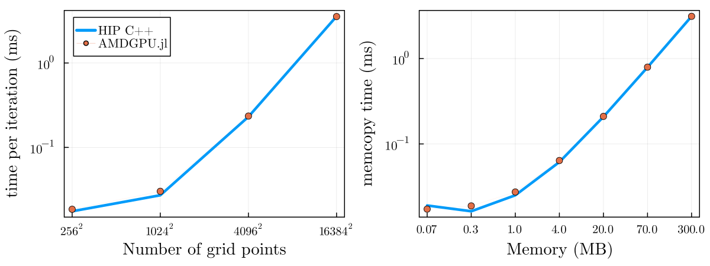

+++
title = "AMD ROCm"
description = "Array and kernel programming for AMD GPUs, with performance comparable to HIP C++ and integration with rocBLAS, rocFFT, rocSOLVER and rocSPARSE."
weight = 2

[[params.packages]]
name = "AMDGPU.jl"
repository = "https://github.com/JuliaGPU/AMDGPU.jl"
documentation = "https://amdgpu.juliagpu.org/stable/"
+++

The Julia programming support for AMD GPUs based on the ROCm platform aims to
provide similar capabilities as the [NVIDIA CUDA](/backends/cuda/) stack, with support
for both low-level kernel programming as well as an array-oriented interface.
[AMDGPU.jl](https://github.com/JuliaGPU/AMDGPU.jl) offers comparable performance
as HIP C++. The toolchain can easily be installed on latest version of Julia 
using the integrated package manager.

AMDGPU.jl makes it possible to program AMD GPUs at different abstraction levels:

- by using the `ROCArray` type, providing a user-friendly yet powerful abstraction
  that does not require any GPU programming experience;
- by writing ROC kernels, with similar performance as kernels written in HIP C++;
- by interfacing with HIP APIs and libraries directly, similar level of flexibility
  you would expect from a C-based programming environment.

The [documentation](https://amdgpu.juliagpu.org/stable/) of AMDGPU.jl demonstrates
each of these approaches.

## Performance

Julia on the CPU is known for its good performance, approaching that of statically
compiled languages like C. The same holds for programming AMD GPUs with kernels
written using AMDGPU.jl, where we show preliminary performance to approach that of
HIP C++ on a memcopy and 2D diffusion kernel:

